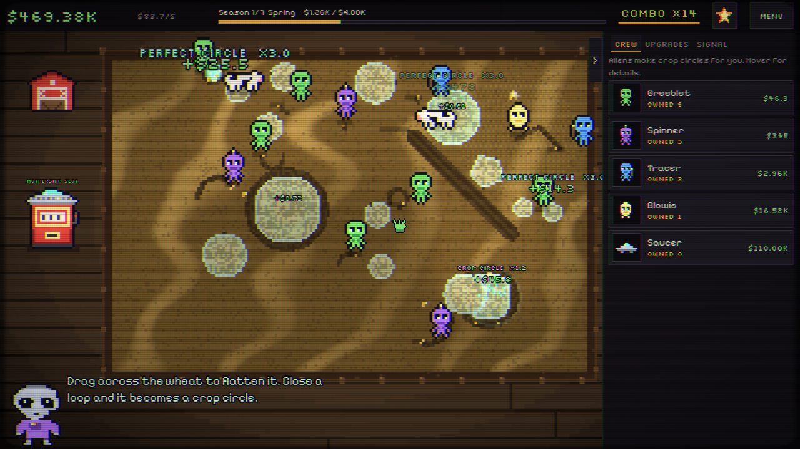

# Crop Circles

*An idle game about extraterrestrial vandalism.* Pixel art, Godot 4.3 (GDScript).

A wheat farm sits on a tabletop. You are an alien operative. Drag across the wheat
to flatten it; close a loop and the standing wheat inside becomes a **crop circle**
that swirls, glows and pays out. Buy alien crew to make circles for you, gamble at
the **Mothership Slot**, and harvest each season for permanent **Signal** upgrades.
Harvest all 7 seasons to make contact.



## How it plays

- **Your hand**: left-drag on the field to flatten wheat. Any pocket of standing
  wheat fully fenced in by flattened wheat locks in as a crop circle.
- **Shape bonuses**: Blob x1, Crop Circle x1.25, Round x1.8, Perfect Circle x3,
  Bullseye (a ring drawn around a circle that's still showing) x4.
- **Golden wheat** sparkles in the field: circle it for a bonus. **Cows** wander
  around: circle one to abduct it (x2).
- **Combo**: circles that land close together in time multiply each other.
- **Crew** (Crew tab): Greeblets walk small circles, Spinners big rings, Tracers copy
  your last shape or draw stars/polygons, Glowies boost circles near them, Saucers
  beam down huge perfect circles. Up to a few of each are shown; extras multiply
  what the visible ones earn.
- **Upgrades** (Upgrades tab): bigger hand, wheat value, alien speed, circle
  lifetime, tourists (idle income from circles on show), combo, golden wheat,
  cows, slot luck.
- **Mothership Slot** (click the machine on the table, or press S): bet 10/25/50%
  or all in, three reels, pairs and triples pay, prizes include giant circles and
  free aliens, three cows = the cows win. Double-or-nothing after a win.
- **Harvest** (Signal tab): once the season goal is earned, the farmer harvests.
  Money, crew and upgrades reset; you earn Signal for permanent perks.

Controls: drag = flatten, Tab = shop panel, S = slot, Esc = pause.
Options (title or pause): CRT strength slider (0 = off; purely visual, clicks are
never offset), sound and music volume, cursor style (alien hand, dot, regular
cursor, triangle, square, hexagon), fullscreen, screen shake.

## Project layout

| Path | What |
| --- | --- |
| `scripts/game.gd` | Autoload `Game`: money, crew, upgrades, seasons, formulas, save/load, settings |
| `scripts/data/defs.gd` | Shop data: aliens, upgrades, Signal perks (prices) |
| `scripts/data/quips.gd` | Everything the Overlord says |
| `scripts/field.gd` + `shaders/field.gdshader` | Wheat grid, flattening, loop detection, circles |
| `scripts/aliens.gd` | Crew AI, cows, saucers |
| `scripts/main.gd` | Wires it together: input, payouts, slot prizes, harvest |
| `scripts/ui/` | HUD/shop, slot machine, menus, theme |
| `scripts/crt.gd`, `scripts/cursor.gd` | CRT overlay, custom cursors |
| `tools/` | Placeholder generators: `gen_art.py`, `gen_sfx.py`, `gen_music.py` |

## Replacing placeholder assets

All art is generated placeholder art. Every sprite pixel equals one wheat cell
(`Game.CELL` = 4 screen pixels), so draw at 1x and keep the same file names and
frame layout (see the docstring in `tools/gen_art.py`). Sounds live in
`assets/sounds/*.wav` and music in `assets/music/theme.wav`; drop in a file with
the same name to replace one.

## Running and testing

Open the folder in Godot 4.3 and press Play. Headless smoke test (wipes your save):

```
godot --headless --path . res://tests/smoke_test.tscn   # exit code 0 = pass
```

Windows build: Project > Export > Windows Desktop (preset included, embeds the pck).
